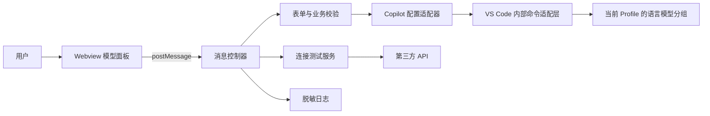
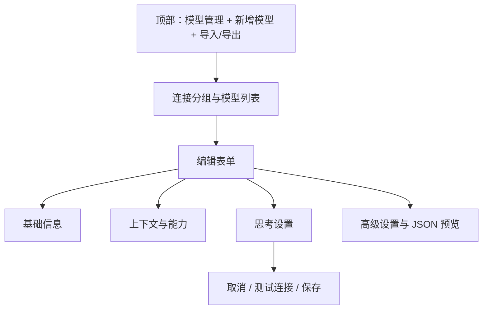

# GitHub Copilot 第三方模型可视化面板：开发文档

> 文档状态：开发前设计（2026-10-29）  
> 目标产品：Visual Studio Code 扩展  
> 建议扩展名：`copilot-model-configurator`  
> 本文中的“视觉模型”指支持图片输入的模型，不是“视角模型”。

## 1. 项目背景

GitHub Copilot 支持通过 BYOK（Bring Your Own Key）接入第三方 OpenAI 兼容模型，但自定义模型的配置入口和字段对普通用户不够直观。本项目提供一个 VS Code 可视化面板，以表单和模型卡片代替手写 JSON，降低配置成本，同时保留高级配置和故障排查能力。

本扩展是配置工具，不是模型代理：不接管 Copilot 的聊天请求，不替换 Copilot 的模型提供方，不承诺第三方接口一定兼容 Copilot。

## 2. 目标与范围

### 2.1 首期目标（MVP）

- 在 VS Code 中通过命令、侧边栏按钮打开模型管理面板。
- 新增、编辑、复制、删除第三方模型配置。
- 配置模型 ID、显示名称、接口地址、API Key 和所属连接分组。
- 配置总上下文窗口、最大输入 Tokens、最大输出 Tokens。
- 配置是否为视觉模型、是否支持工具调用、是否启用流式输出。
- 配置是否支持思考、允许的思考强度及默认思考强度。
- 根据接口类型配置思考强度参数的传递格式。
- 可选：在保存前测试连接，展示明确、可操作的错误。
- 保存后能从当前配置中重新读取结果；其他模型和连接分组不被覆盖。
- 提供导入、导出、JSON 预览及官方模型管理入口作为高级功能。

### 2.2 非目标

- 不实现独立聊天窗口、提示词管理、模型计费或用量统计。
- 不保证模型声明的能力与真实服务一致；例如勾选“视觉”不会使纯文本模型获得视觉能力。
- 不自动扫描、购买或选择第三方模型服务。
- 不在前端直接访问第三方接口，避免 Webview 的 CORS、混合内容和凭据暴露问题。
- 不修改用户其他供应商配置，不以整体覆盖 `settings.json` 的方式写入。
- MVP 不处理多设备配置同步冲突；当前 Profile 中的最后一次有效写入生效。

## 3. 已核对的 Copilot 配置契约

### 3.1 版本与兼容性说明

VS Code / Copilot 的 BYOK 配置仍在演进。截至本文核对时：

1. 旧版使用 `github.copilot.chat.customOAIModels`，是以模型 ID 为键的对象。
2. 当前 Copilot 会迁移该设置，使用语言模型提供方分组；OpenAI 兼容提供方的 `vendor` 为 `customoai`。
3. 当前 VS Code 源码中，OpenAI Compatible（`customoai`）已出现弃用提示，因此不能把现有字段当作永久稳定 API。
4. 语言模型分组的读取、更新是 VS Code 内部服务；扩展没有等价、稳定的公开 API。
5. 可通过内部命令 `lm.migrateLanguageModelsProviderGroup` 请求 VS Code 合并一个分组，但仍需版本探测和回归测试。
6. 思考强度的实际选择由模型选择器管理，并可按聊天会话保存；面板配置的是模型支持的强度和默认值，不应伪造“所有会话统一切换成功”的状态。

因此，**配置写入必须集中在扩展后端的适配器中，不能散落在 Webview 代码中**。

### 3.2 当前分组结构

一个连接分组包含一组模型。分组名用于区分供应商、账号或凭据；同一 `vendor + name` 下可保存多个模型。

```json
[
  {
    "vendor": "customoai",
    "name": "My Provider",
    "models": [
      {
        "id": "provider-model-id",
        "name": "My Model",
        "url": "https://api.example.com/v1/chat/completions",
        "contextWindow": 128000,
        "maxInputTokens": 120000,
        "maxOutputTokens": 8000,
        "toolCalling": true,
        "vision": true,
        "thinking": true,
        "streaming": true,
        "supportsReasoningEffort": ["low", "medium", "high"],
        "defaultReasoningEffort": "medium",
        "reasoningEffortFormat": "chat-completions"
      }
    ]
  }
]
```

上面是字段映射示例，不代表稳定公开 Schema。`defaultReasoningEffort` 虽存在于 Copilot 当前通用 BYOK 能力模型中，但在 CustomOAI 的显式配置类型中未完整声明；实现时必须通过目标版本实测，不支持时仅展示“在模型选择器中设置”。

### 3.3 模型字段映射

| 面板字段 | 配置字段 | 类型 | 规则 |
| --- | --- | --- | --- |
| 模型 ID | `id` | `string` | 必填；同一分组内唯一；原样发送给服务方 |
| 显示名称 | `name` | `string` | 必填；用于模型选择器展示 |
| API 地址 | `url` | `string` | 必填；优先填写完整端点 |
| 总上下文窗口 | `contextWindow` | `number` | 正整数；输入与输出的总窗口 |
| 最大输入 Tokens | `maxInputTokens` | `number` | 正整数；小于等于总窗口 |
| 最大输出 Tokens | `maxOutputTokens` | `number` | 正整数；输入与输出之和等于总窗口 |
| 工具调用 | `toolCalling` | `boolean` | 仅在服务方真实支持时开启 |
| 视觉模型 | `vision` | `boolean` | 是否允许图片输入 |
| 思考能力 | `thinking` | `boolean` | 是否声明模型具有思考能力 |
| 流式输出 | `streaming` | `boolean` | 默认开启；兼容性异常时可关闭 |
| 支持的思考强度 | `supportsReasoningEffort` | `string[]` | 思考开启时至少一项；空数组等价于不提供选择 |
| 默认思考强度 | `defaultReasoningEffort` | `string` | 必须包含于支持列表；目标版本支持时才写入 |
| 强度参数格式 | `reasoningEffortFormat` | 枚举 | 见下节 |

**上下文长度口径：** `contextWindow` 表示完整上下文窗口，不能把它同时当成最大输入。若用户只填写总窗口和最大输出，则：

$$
\text{maxInputTokens}=\text{contextWindow}-\text{maxOutputTokens}
$$

MVP 使用显式三个数值，并在总窗口变化时给出联动选项；不要把自动换算后的值与服务商标注的独立输入限制混为一谈。若服务商分别给出输入限制和总窗口且二者不一致，以服务商文档为准，并允许高级编辑。

### 3.4 API 地址规则

当前 Copilot 对 CustomOAI 地址的主要处理规则：

- 已包含 `/chat/completions` 或 `/responses`：视为完整端点，不再追加路径。
- 以 `/v1` 等版本路径结尾：追加 `/chat/completions`。
- 其他基础地址：追加 `/v1/chat/completions`。

为避免不同版本推导差异，表单默认引导用户填写完整端点，并在旁边实时显示“Copilot 当前推导的请求地址”。MVP 不自行重写用户保存的 URL。

### 3.5 思考强度的语义

思考强度不是 `thinking: true` 的同义词：前者声明思考能力，后者控制是否暴露、支持哪些强度以及请求中的强度值。

| 格式选项 | 配置值 | 请求体字段 |
| --- | --- | --- |
| Chat Completions | `chat-completions` | 顶层 `reasoning_effort` |
| Responses | `responses` | 嵌套 `reasoning.effort` |
| Messages | `messages` | 嵌套 `output_config.effort` |

- 默认按 API 路径推导，同时允许高级用户覆盖。
- 常用档位为 `low`、`medium`、`high`，实际允许值由模型和服务方决定，不在代码中强制只支持这三档。
- 未声明 `supportsReasoningEffort` 时，Copilot 不应转发面板中随意填写的强度。
- 当前 CustomOAI 源码未显式转发 `defaultReasoningEffort` 到最终端点能力对象；故“默认强度”列为兼容性增强项。若目标版本不生效，界面必须提示用户到模型选择器中调整，而不是保存一个无效选项。

### 3.6 API Key 与分组

- 同组模型共享分组凭据；不同 API Key 或服务账号应使用不同分组。
- 新增时可输入 API Key；本地服务可无 Key，但需用户明确选择“无需认证”。
- 编辑或复制已有模型时，认证方式由所属分组是否已保存凭据推断：分组无凭据即沿用“无需认证”，不要求重新选择。
- 编辑时 Key 输入框保持为空，显示“已配置，不修改则保留”，绝不将原密钥回显到 Webview。
- 密钥不得写入扩展日志、遥测、全局状态、Webview 状态或错误堆栈。
- 优先沿用 Copilot 当前版本的凭据管理方式；如果当前内部分组仅接受 `apiKey` 字段，后端仅在调用写入命令时传递，且必须确认实际存储位置，不能宣称扩展自行加密保存。
- 删除模型不应自动删除仍被其他模型使用的凭据。删除分组凭据需单独确认。
- 导出默认排除密钥；只有后续设计独立的安全导入流程后才能考虑凭据迁移。

## 4. 技术方案

### 4.1 技术选型

- **扩展宿主：** VS Code Extension API，TypeScript。
- **UI：** 原生 HTML + CSS + TypeScript；以 VS Code Webview 为主，不引入 React 等重型框架。
- **构建：** esbuild，分别构建扩展后端和 Webview 前端。
- **测试：** Node 内置测试运行器或项目统一的 Vitest；VS Code 集成测试使用 `@vscode/test-electron`。
- **包管理：** 使用项目初始化时选定的 npm， lockfile 一并提交。
- **支持平台：** Windows、macOS、Linux 桌面版。Web 版 VS Code 不纳入 MVP。

不依赖私有 Copilot npm 包，不复制 Copilot 源码。与内部命令相关的类型在本项目内定义并隔离。

### 4.2 组件架构



| 模块 | 职责 |
| --- | --- |
| `extension.ts` | 注册命令、视图、面板和生命周期 |
| `ModelPanel` | 创建/复用 Webview，配置 CSP、nonce 和资源白名单 |
| `MessageController` | 校验消息类型、请求 ID、数据来源，调用后端服务 |
| `ModelConfigService` | 表单校验、配置映射、冲突检测、保存后回读 |
| `CopilotConfigAdapter` | 唯一的 Copilot 读写边界；能力检测和错误转换 |
| `ConnectionTester` | 后端发起最小请求、超时与取消、脱敏错误 |
| `webview/` | 列表、表单、JSON 预览、通知；不持有密钥和配置写权限 |

### 4.3 推荐目录

```text
.
├── package.json
├── tsconfig.json
├── esbuild.mjs
├── src/
│   ├── extension.ts
│   ├── panel/ModelPanel.ts
│   ├── panel/MessageController.ts
│   ├── models/modelConfig.ts
│   ├── services/ModelConfigService.ts
│   ├── services/ConnectionTester.ts
│   ├── adapters/CopilotConfigAdapter.ts
│   ├── adapters/CurrentGroupAdapter.ts
│   ├── adapters/LegacySettingsAdapter.ts
│   └── webview/
│       ├── main.ts
│       ├── styles.css
│       └── index.html
├── test/
│   ├── unit/
│   └── integration/
└── DEVELOPMENT.md
```

## 5. 界面与交互设计

### 5.1 页面结构



- 顶栏：标题、刷新、添加模型、更多操作。
- 左侧：按连接分组展示模型卡片，显示名称、模型 ID、上下文摘要及视觉/思考标记。
- 右侧：分组设置与模型表单；窄屏时改为列表 → 编辑的单列导航。
- 底部固定操作区：取消、测试连接、保存；离开未保存表单时确认。
- 高级区：折叠展示原始 JSON、参数格式和旧版配置导入。
- 使用 VS Code 主题变量，如 `--vscode-editor-background`、`--vscode-foreground`、`--vscode-focusBorder`，支持深色/浅色/高对比主题。

### 5.2 表单分区与默认值

**基础信息**

- 连接分组：选择已有分组或新建分组。
- 模型 ID：无默认值，不以显示名称自动覆盖已编辑的 ID。
- 显示名称：默认可与 ID 相同。
- API 地址：必填，URL 校验在失焦时进行。
- 认证方式：API Key / 无认证；不预填已有密钥。

**上下文与能力**

- 总上下文窗口：建议默认 `128000`，仅为表单初值，不冒充模型真实能力。
- 最大输出 Tokens：建议默认 `4096`。
- 最大输入 Tokens：由上述两项计算，可编辑；编辑后要求三项满足约束。
- 视觉模型：默认关闭。
- 工具调用：默认开启，但用户应根据服务方能力调整。
- 流式输出：默认开启。

**思考设置**

- 思考能力：默认关闭。
- 支持强度：思考开启后显示，常用档位复选框 + 自定义值。
- 默认强度：从支持列表中选择；无默认时显示“使用 Copilot/服务方默认”。
- 参数格式：默认自动，高级模式下可覆盖。
- 文案：“此默认值是否生效取决于 Copilot 版本；聊天中可在模型选择器调整。”

### 5.3 状态与反馈

- **加载：** 显示骨架或进度，不用空列表伪装加载完成。
- **空状态：** 说明用途，提供“添加第一个模型”。
- **校验错误：** 字段旁展示原因，保存按钮不可用；顶部提供错误汇总。
- **保存中：** 禁止重复提交；成功后重新读取配置并刷新列表。
- **部分失败：** 不允许显示“保存成功”；说明哪些操作未执行，提供重试。
- **连接失败：** 区分 DNS/连接、超时、TLS、401/403、404、429、5xx 和响应格式问题。
- **版本不兼容：** 禁用自动写入，解释原因，提供 JSON 导出和官方模型管理入口。
- **危险操作：** 删除模型、删除分组、覆盖同名模型均需明确确认。

### 5.4 可访问性

- 所有输入有持久可见的 `label`，不只依赖 placeholder。
- 全键盘可用；焦点顺序与视觉顺序一致；对话框正确管理焦点。
- 图标按钮具有 `aria-label`；状态通知使用适度的 live region。
- 不仅用颜色表达错误、选中和能力状态。
- 支持 200% 缩放和窄面板，不出现不可达操作。

## 6. 核心数据与校验

### 6.1 扩展内部模型

内部表单类型与 Copilot 持久化类型分离，防止上游字段变化污染 UI。

```typescript
export type ReasoningEffortFormat =
  | 'chat-completions'
  | 'responses'
  | 'messages';

export interface ModelDraft {
  groupName: string;
  id: string;
  name: string;
  url: string;
  contextWindow: number;
  maxInputTokens: number;
  maxOutputTokens: number;
  toolCalling: boolean;
  vision: boolean;
  thinking: boolean;
  streaming: boolean;
  supportsReasoningEffort: string[];
  defaultReasoningEffort?: string;
  reasoningEffortFormat?: ReasoningEffortFormat;
  apiKey?: string;
  credentialUnchanged?: boolean;
}
```

必须保留原分组中未被面板识别的字段，使用“读取原模型 → 修改已知字段 → 合并回原对象”，不要用仅含表单字段的新对象盲目替换。

### 6.2 校验规则

1. 分组名、模型 ID、显示名称、URL 去除首尾空白后非空。
2. URL 仅允许 `https:`；`http:` 仅用于用户明确确认的本地/可信开发服务。
3. 同一分组内模型 ID 唯一；跨分组的同名模型可以存在。
4. Token 值必须是安全整数且大于零，不使用浮点数或科学计数法字符串。
5. 必须满足 `maxInputTokens + maxOutputTokens = contextWindow`，避免 Copilot 内部推导不一致。
6. 思考关闭时，清空强度列表和默认强度；思考开启时至少一个合法强度。
7. 默认强度必须属于支持列表；自定义强度去除空白并去重。
8. 分组名不可与当前 Profile 中其他 `customoai` 分组冲突。
9. 外部配置发生变化时，不直接覆盖；重新加载或让用户确认合并。
10. 后端重复执行所有关键校验，不能信任 Webview 消息。

## 7. 读取、保存与兼容策略

> 实现现状：目前目标是 `customendpoint`（推荐）与 `customoai`（已弃用，仅兼容）。
> 具体实现见 [IMPLEMENTATION.md](./IMPLEMENTATION.md)。

### 7.1 当前版本：优先分组写入

`CurrentGroupAdapter` 使用以下内部命令，让 VS Code 自己执行分组新增或更新：

```typescript
await vscode.commands.executeCommand(
  'lm.migrateLanguageModelsProviderGroup',
  {
    vendor: 'customendpoint',
    name: draft.groupName,
    models: [/* 合并后的完整模型列表 */]
  }
);
```

实测结论（VS Code 1.141.1 / Copilot 0.69.0）：

- 不带新密钥可直接合并写文件，能完整保留未知字段；
- 带新密钥时，VS Code 只在分组注册流程中加密保存密钥，因此需移除目标分组后重建，失败时恢复原分组；
- 内部命令会保留其他分组与其他提供方，但不会自动合并同名分组，需自行先读取再合并。

注意：

- 这是内部命令而非公开扩展 API；不能假定所有 VS Code 版本都存在。
- 传入的是该分组合并后的模型列表，但必须先读取、保留同组其他模型和未知字段。
- 读取同样受内部能力限制。优先使用 VS Code 当前分组配置命令/资源；无法读取时禁止自动覆盖，转入导出模式。
- 每次写入后以读取结果为准，而非只依据命令未抛异常判定成功。
- 将内部命令调用集中在一个适配器中，以便未来替换为公开 API。
- 固定 `groupName` 作为分组身份；MVP 不提供直接重命名，以免意外新建分组并留下旧配置。

### 7.2 读取与冲突处理

1. 面板打开时请求当前 Profile 的配置快照，并记录版本标识或哈希。
2. 用户编辑只修改内存草稿，不即时写配置。
3. 保存时重新读取并对比快照；无冲突则仅合并目标分组和目标模型。
4. 若分组在外部被修改、删除或由 Copilot 迁移，提示用户刷新后重试。
5. 其他供应商、其他分组、用户设置和未知字段保持不变。
6. 禁止并发写入；同面板保存操作串行执行。

### 7.3 旧版设置

`LegacySettingsAdapter` 仅作为兼容与迁移辅助：

- 检测 `github.copilot.chat.customOAIModels`，只读加载并提供“导入到面板”。
- 不在同一版本中同时写新分组和旧设置，避免 Copilot 再次迁移产生重复模型。
- 不自动删除旧设置；迁移结果经用户确认后，再提供单独清理操作。
- 对无法使用新分组命令的旧版 VS Code，可提供明确标记的旧格式导出，不默认双写。

### 7.4 无法调用内部接口时

- 展示兼容性说明和 Copilot 当前版本检测信息。
- 允许导出完整分组 JSON 或复制到剪贴板，默认不包含密钥。
- 提供打开 VS Code 官方语言模型配置/管理界面的动作；具体命令需在目标版本实测后注册。
- 不猜测用户配置文件的绝对路径，不直接篡改 VS Code 内部状态数据库。
- 未来若出现稳定公开 API，新增适配器并保持 UI 不变。

## 8. Webview 通信协议

所有消息带 `type`、`requestId` 和 `payload`；响应通过 `requestId` 关联。拒绝未知消息类型和不合法数据。

| 请求 | 后端行为 | 成功返回 |
| --- | --- | --- |
| `config/list` | 获取当前配置与适配器能力 | 分组、模型快照、能力标记 |
| `config/save` | 校验、合并、写入、回读 | 最新快照 |
| `config/delete` | 删除指定模型并回读 | 最新快照 |
| `connection/test` | 使用草稿进行受限测试 | 状态、耗时、脱敏消息 |
| `config/export` | 生成脱敏 JSON | 导出文本 |
| `config/import` | 解析并校验，不立即保存 | 待确认草稿 |
| `panel/openOfficial` | 打开官方配置入口 | 无 |

```typescript
export interface SaveModelRequest {
  type: 'config/save';
  requestId: string;
  payload: {
    originalGroupName?: string;
    originalModelId?: string;
    expectedSnapshotHash: string;
    draft: ModelDraft;
  };
}

export interface ModelResponse<T> {
  requestId: string;
  ok: boolean;
  data?: T;
  error?: {
    code: string;
    message: string;
    field?: string;
  };
}
```

- 请求 ID 使用后端可验证的一次性标识，防止重复保存。
- API Key 只存在于当前添加/测试/保存请求中，响应中不返回。
- 错误消息脱敏：移除 Authorization、URL 查询参数、请求头和可能的响应敏感内容。
- Webview 使用 CSP：`default-src 'none'`，脚本仅允许 nonce，样式和连接源按最小范围配置；不使用 `innerHTML` 渲染用户输入。

## 9. 连接测试设计

连接测试是可选项，不是保存成功的前置条件；许多服务无统一 `/models` 实现。

1. 优先向当前完整 Chat Completions 端点发送最小请求，包含模型 ID、一条短文本和很小的输出限制。
2. 不为了“测试”默认发送图片、工具或高强度思考请求；这些可作为后续独立测试。
3. 测试前明确提示会向第三方发送一条测试消息，可能产生少量费用。
4. 超时默认 15 秒，可取消；新测试开始时取消旧测试。
5. 后端使用受控 HTTP 客户端，限制重定向、响应体大小和错误内容长度。
6. 不允许 Webview 提供任意请求头或代理执行代码；自定义请求头留到后续安全设计。
7. 连接成功仅表示最小请求成功，不代表视觉、工具调用或思考强度全部验证通过。

## 10. 安全与隐私

- 默认不收集遥测；如后续增加，必须单独说明、脱敏并允许关闭。
- 密钥仅通过后端短暂传递；不进入 DOM 持久状态、日志、导出的 JSON 或测试文件。
- 用户主动触发连接测试前，不向草稿中的 URL 发请求。
- 所有第三方域名、响应错误和模型内容均视为不可信数据。
- 严格 Webview CSP、nonce、本地资源白名单和输出转义。
- 发布前检查 VSIX 不包含测试密钥、个人配置、日志或缓存。
- 日志只记录操作类型、错误分类和版本信息，默认不记录完整 URL、模型返回正文或凭据。
- 配置同步可能使用户配置跨设备传播，界面需说明配置作用域为当前 Profile。

## 11. 测试计划

### 11.1 单元测试

- 表单字段映射、往返转换、未知字段保留。
- 总窗口、输入、输出的计算与边界值；`0`、负数、小数、非数字、超大值。
- 模型 ID 和分组名去重；同组与跨组差异。
- 思考关闭时清理强度；默认强度不在支持列表时拒绝保存。
- 完整 `/chat/completions`、`/responses`、`/v1` 与基础 URL 的显示推导。
- 三种思考强度参数格式的映射。
- 导入非法 JSON、缺失字段、未知字段和不含密钥导出。
- 配置合并不删除其他模型、其他分组或无关设置。
- 快照冲突、命令不存在、命令失败、写入后回读不一致。
- 日志与错误中不出现 API Key。

### 11.2 Webview 测试

- 新增、编辑、复制、取消、删除确认和未保存离开确认。
- 思考开关、默认值选项、视觉/工具/流式开关的联动。
- 慢加载、空状态、保存失败、重复点击、长模型名和窄屏。
- 键盘、焦点、屏幕阅读器标签、主题与高对比模式。
- 用户输入按文本渲染，不执行 HTML 或脚本。

### 11.3 集成与手工验收

在每个声明支持的 VS Code Stable / Insiders + Copilot Chat 版本组合上执行：

1. 无配置时添加首个分组和模型。
2. 同组添加第二个模型，第一个模型保持不变。
3. 编辑视觉、上下文和思考能力，重载窗口后核对配置和模型选择器。
4. 使用低/中/高强度发送请求，在可控测试服务器核对请求体字段。
5. 分别验证 Chat Completions 和 Responses 端点。
6. 图片输入模型能正确发送图片；非视觉模型不出现伪支持声明。
7. 旧 `customOAIModels` 配置能导入，不重复迁移、不静默删除。
8. 有密钥与无密钥服务分别测试；密钥不出现在日志、DOM 和导出文件。
9. 外部修改配置后保存，出现冲突而非覆盖。
10. 内部命令不可用时，界面提供导出兜底，且不写入任何配置。

## 12. 开发里程碑

| 阶段 | 交付内容 | 完成条件 |
| --- | --- | --- |
| M0：兼容性验证 | 目标版本矩阵、分组读写 PoC、思考字段实测 | 确认可用命令、实际存储和回读路径 |
| M1：扩展骨架 | 命令、Webview、CSP、消息协议、构建与测试 | 可打开面板并完成类型安全通信 |
| M2：模型管理 | 列表、增删改、校验、合并、回读 | 不影响已有模型与配置 |
| M3：能力配置 | 上下文、视觉、工具、流式、思考强度 | 映射与目标版本行为通过集成测试 |
| M4：安全与兼容 | 凭据流程、冲突检测、旧配置导入、导出兜底 | 安全测试与无内部命令场景通过 |
| M5：体验与发布 | 连接测试、主题、可访问性、错误文案、打包 | 验收清单完成，VSIX 内容审查通过 |

**M0 是后续开发的前置条件。** 如果当前分组方案无法稳定读取，不应继续实现“自动写入”的假象，应先确定可用的公开扩展点或采用导出方案。

## 13. 验收标准

- 用户无需手写 JSON 即可完成第三方模型的添加与修改。
- 可独立配置上下文窗口、输入/输出 Tokens、视觉能力和思考强度选项。
- 保存结果可在 Copilot 配置中回读，模型可在 Copilot 模型选择器中使用。
- 思考强度说明准确，不把模型能力声明或默认值描述为所有会话的强制设置。
- 保存与删除不覆盖其他模型、分组、未知字段或无关设置。
- 密钥不回显、不进入日志和默认导出；网络请求只由用户主动触发。
- 不支持的 VS Code/Copilot 版本有明确提示和无损导出方案。
- 核心单元测试、目标版本集成测试、键盘与窄屏检查全部通过。

## 14. 风险与后续演进

| 风险 | 应对 |
| --- | --- |
| Copilot 内部配置格式或 `customoai` 变化 | 适配器隔离、运行时能力检测、版本矩阵测试、导出兜底 |
| 无公开读取 API | M0 先做 PoC；不可读时禁止自动覆盖 |
| 模型声称支持但接口不兼容 | 明确提示、最小连接测试、按能力分别排错 |
| 默认强度不被目标版本识别 | 实测后开放；否则引导模型选择器，不写虚假状态 |
| 分组共享 Key 导致误改 | 分组独立编辑、Key 不回显、删除凭据单独确认 |
| 外部配置并发修改 | 快照哈希、写前重读、冲突提示、串行写入 |
| 非 OpenAI 兼容供应商差异 | 后续增加独立 ProviderAdapter，不在表单中堆叠特例 |

后续可增加：服务商预设模板、按能力筛选、配置健康检查、独立视觉/工具测试、无密钥配置备份。每一项都应继续通过同一适配器和校验层，不绕过安全边界。

## 15. 参考资料

以下资料用于核对当前行为，访问/核对日期为 2026-10-29；内部源码不是稳定性承诺。

- [VS Code：AI language models / BYOK 与模型参数](https://code.visualstudio.com/docs/agent-customization/language-models)
- [VS Code：CustomOAI 提供方及字段处理](https://github.com/microsoft/vscode/blob/cf022b68301a34bef8fd1e777dc639305ebe5b6c/extensions/copilot/src/extension/byok/vscode-node/customOAIProvider.ts)
- [VS Code：BYOK 通用模型能力](https://github.com/microsoft/vscode/blob/cf022b68301a34bef8fd1e777dc639305ebe5b6c/extensions/copilot/src/extension/byok/common/byokProvider.ts)
- [VS Code：思考强度配置 Schema](https://github.com/microsoft/vscode/blob/cf022b68301a34bef8fd1e777dc639305ebe5b6c/extensions/copilot/src/extension/byok/vscode-node/byokModelInfo.ts)
- [VS Code：OpenAI 兼容请求与思考强度转发](https://github.com/microsoft/vscode/blob/cf022b68301a34bef8fd1e777dc639305ebe5b6c/extensions/copilot/src/extension/byok/node/openAIEndpoint.ts)
- [VS Code：语言模型分组配置服务](https://github.com/microsoft/vscode/blob/cf022b68301a34bef8fd1e777dc639305ebe5b6c/src/vs/workbench/contrib/chat/browser/languageModelsConfigurationService.ts)
- [VS Code：语言模型分组迁移命令](https://github.com/microsoft/vscode/blob/cf022b68301a34bef8fd1e777dc639305ebe5b6c/src/vs/workbench/contrib/chat/browser/actions/chatLanguageModelActions.ts)
- [VS Code：Webview API](https://code.visualstudio.com/api/extension-guides/webview)
